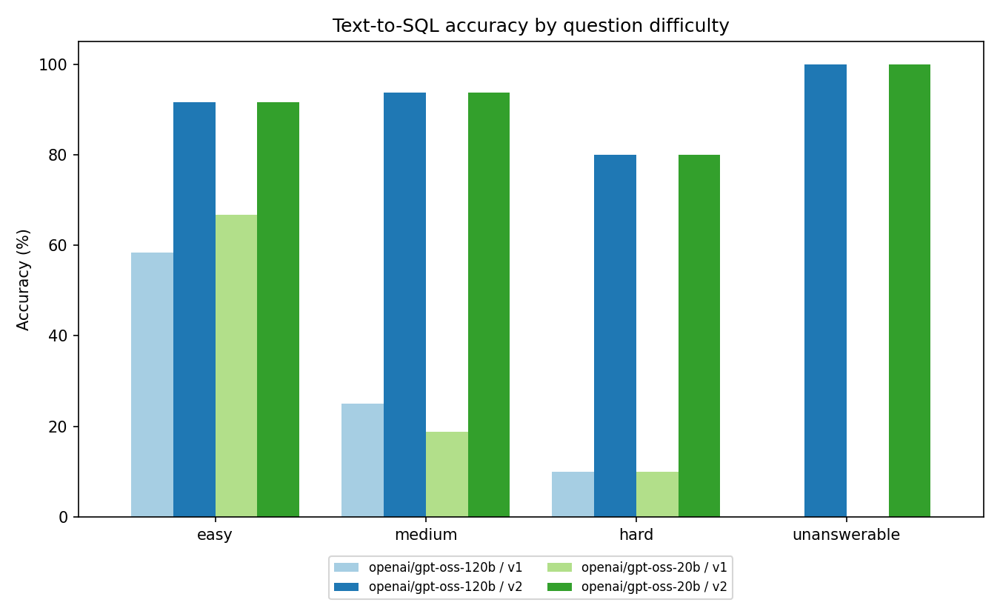
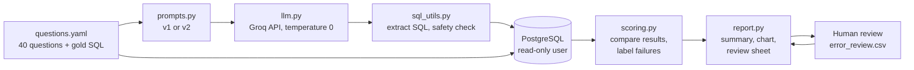

# LLM Text-to-SQL Evaluation

[](https://github.com/Kolawole162/llm_text_to_sql_evaluation/actions/workflows/ci.yml)

How well can a large language model answer business questions about a real database by writing SQL?
This project builds a 40-question benchmark on my **RushMore pizzeria** PostgreSQL database, scores model
answers automatically by **running their SQL and comparing the results** with hand-written gold answers,
classifies every failure, and finishes with a **human review** of the errors.

It compares two models (OpenAI's open-weight **gpt-oss-120b** and **gpt-oss-20b**, served by Groq) and two
prompt designs (a bare **v1** and an engineered **v2**).

## Key results



| Model / prompt | Automatic score | After human review | Easy | Medium | Hard | Unanswerable |
|---|---|---|---|---|---|---|
| gpt-oss-120b / v1 | 30% (12/40) | 30% (12/40) | 7/12 | 4/16 | 1/10 | 0/2 |
| gpt-oss-120b / v2 | 90% (36/40) | **97.5% (39/40)** | 11/12 | 15/16 | 8/10 | 2/2 |
| gpt-oss-20b / v1 | 30% (12/40) | 30% (12/40) | 8/12 | 3/16 | 1/10 | 0/2 |
| gpt-oss-20b / v2 | 90% (36/40) | **95% (38/40)** | 11/12 | 15/16 | 8/10 | 2/2 |

**What the numbers show**

1. **Prompt design mattered far more than model size.** Moving from v1 to v2 raised accuracy from 30% to 90%
   for both models. Without the schema, the models invented column names: 26 and 25 of their failures were
   `unknown_column` errors.
2. **v2 removed hallucinated answers.** Asked questions the data cannot answer (ingredient usage per pizza,
   delivery times), both models wrote confident SQL under v1. Under v2, which permits the reply `CANNOT_ANSWER`
   and shows an example of it, both declined correctly (2/2).
3. **Human review separated the models.** The automatic scores were identical (90%), but 5 of the 8 v2
   failures were correct answers in a different format (month shown as `2026-01-01` instead of `1`).
   After review, the big model scored 97.5% and the small model 95%. The small model made one extra real
   error: a GROUP BY mistake.
4. **The remaining real error is a data-value assumption.** Both models searched for a pizza named
   `'Pepperoni Pizza'` with size `'Large'`, but the stored name is `'Large Pepperoni Pizza'`. The schema
   alone cannot reveal how values are written; sample values in the prompt are the next fix.
5. **v2 costs more input but less output.** Its prompt is about 7× longer (846 vs 116 tokens), yet answers
   were 3–4× shorter and faster, because the models stopped reasoning about guessed table structures.

## How it works



### The benchmark

[`eval/questions.yaml`](eval/questions.yaml) holds 40 questions, each with a gold SQL query:

| Difficulty | Count | Examples |
|---|---|---|
| Easy | 12 | single table: counts, filters, a price lookup |
| Medium | 16 | joins and grouping: revenue per store, monthly revenue, customers with no orders |
| Hard | 10 | window functions and subqueries: best seller per store, month-on-month change, running totals |
| Unanswerable | 2 | the needed data does not exist; the correct answer is `CANNOT_ANSWER` |

Questions that ask for a "top" item were checked for ties, and one was reworded, so every question has
exactly one correct answer.

### Scoring: execution accuracy

A model's SQL is run against the database and its **result** is compared with the gold result, so two
differently written queries that return the same data are both correct. The comparison:

- rounds numbers to 2 decimal places and treats `1`, `1.0` and `Decimal('1.00')` as equal;
- ignores case and surrounding spaces in text, and ignores column names and column order;
- allows extra columns, provided every gold column is present;
- checks row order only when the question asks for an order;
- keeps rows intact (columns cannot be matched independently), and does not treat `NULL` as `0`.

Every failure gets an automatic label: `unknown_column`, `syntax_error`, `grouping_error`, `timeout`,
`wrong_row_count`, `wrong_values`, `hallucinated_answer`, `unsafe_sql` and others, taken from the
PostgreSQL error code where there is one.

### Human review

`python -m sqleval.report` writes [`results/error_review.csv`](results/error_review.csv), which lists every
failure with empty `root_cause` and `notes` columns. I reviewed all v2 failures using four labels:

| root_cause | Meaning | Count (v2) |
|---|---|---|
| `format_only` | correct answer in a different format; counted as correct after review | 5 |
| `wrong_value_assumption` | the model guessed how a value is stored and guessed wrong | 2 |
| `sql_error` | invalid SQL | 1 |
| `wrong_logic` | valid SQL that answers the question wrongly | 0 |

### Safety

Model-written SQL is untrusted code, so it is contained at two levels:

1. **In Python:** only a single `SELECT`/`WITH` statement with no write or DDL keywords is executed.
2. **In the database:** queries run as `eval_reader`, a user with `SELECT` permission only, read-only
   transactions by default and a 5-second statement timeout. Even a missed `DELETE` is refused by
   PostgreSQL itself, and every transaction is rolled back.

## Validating the evaluator

An evaluation is only as good as its scorer, so the scorer is tested before any model is:

- **Unit tests** (16, pytest) cover SQL extraction, the safety check and every comparison rule, including
  cases that must *fail*, such as mixed-up rows and `NULL` versus `0`.
- **A gold self-check** (`--model gold`) feeds the gold answers through the whole pipeline. It must score
  100%, and CI fails if it does not.
- **A scorer bug was found and fixed during the project.** The first v1 results were 22% and 2%, with most
  failures labelled `unsafe_sql`. Inspecting the replies showed the models had begun their SQL with a
  comment line (`-- Count customers`), which the safety check rejected as not starting with `SELECT`.
  Comments are now stripped first, a test covers the case, and the saved replies were re-scored with
  `--rescore`, without new API calls. The true v1 score was 30% for both models.

## Run it yourself

**Requirements:** Docker Desktop, Python 3.12+, and a free Groq API key from <https://console.groq.com>.

```bash
# 1. Start PostgreSQL with the schema, sample data and read-only user
docker compose up -d

# 2. Install packages and configure
python -m venv venv
venv\Scripts\activate                 # Windows  (macOS/Linux: source venv/bin/activate)
pip install -r requirements.txt
copy .env.example .env                # then put your Groq key in .env
set PYTHONPATH=src                    # macOS/Linux: export PYTHONPATH=src

# 3. Check the evaluator, then run a model
pytest -v
python -m sqleval.run_eval --model gold
python -m sqleval.run_eval --model openai/gpt-oss-120b --prompt v2

# 4. Build the summary, chart and review sheet
python -m sqleval.report
```

Other options: `--limit 3` runs only the first 3 questions, `--rescore` re-marks saved replies with the
current scorer, and `--pause` sets the seconds between API calls.

## Project structure

```
├── db/
│   ├── 01_schema.sql          # RushMore tables
│   ├── 02_data.sql            # sample data (generated, seed 42)
│   ├── 03_readonly_role.sql   # read-only evaluation user
│   └── generate_data.py       # reproducible data generator
├── eval/questions.yaml        # 40 questions with gold SQL
├── src/sqleval/
│   ├── db.py                  # connection and safe execution
│   ├── prompts.py             # prompt v1 and v2
│   ├── llm.py                 # Groq client with retries
│   ├── sql_utils.py           # SQL extraction and safety check
│   ├── scoring.py             # result comparison and failure labels
│   ├── run_eval.py            # runs one model + prompt
│   └── report.py              # summary, chart, review sheet
├── results/                   # saved replies, summary, chart, human review
├── tests/                     # pytest unit tests
├── docker-compose.yml
└── .github/workflows/ci.yml   # tests + gold self-check against Postgres
```

## Limitations and next steps

- **Small benchmark.** 40 questions give a clear signal on prompt design, but a gap of one question
  (97.5% vs 95%) is not statistically meaningful. Next: grow the benchmark to 100+ questions.
- **One run per configuration.** Temperature 0 makes replies as repeatable as possible, but not perfectly.
  Next: repeat each run 3 times and report the spread.
- **One model family.** Both models are gpt-oss. Next: add models from other providers.
- **Prompt v3.** Add sample values for text columns (to fix the `'Large Pepperoni Pizza'` error) and a
  self-repair step that shows the model its database error and lets it try once more.
- **Scorer format rules.** Months-as-dates were caught by human review; an option to accept equivalent
  date formats would reduce manual work.

## Data

The data is synthetic: customers and orders were generated with Faker using a fixed seed, so no real
person is represented. The schema comes from my RushMore capstone project.

## Author

Kolawole Samson Bolarinwa · [LinkedIn](https://linkedin.com/in/kolawole-bolarinwa-b1bb30138) · [GitHub](https://github.com/Kolawole162)
